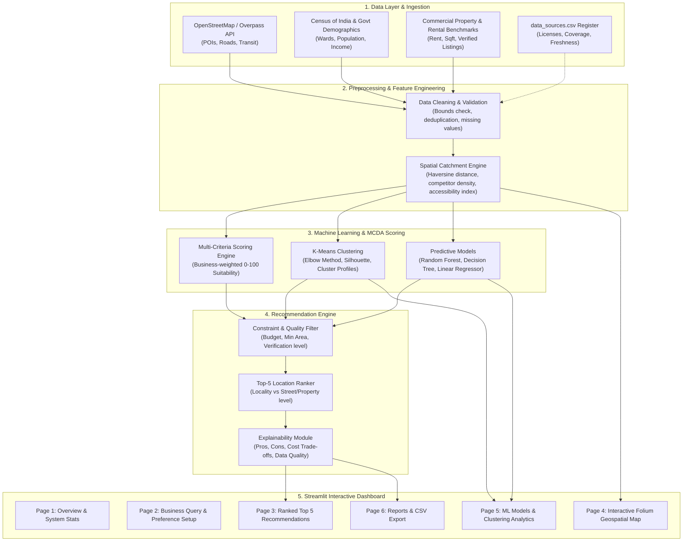

# AI-Based Business Location Selector: System Architecture & Implementation Roadmap

## 1. System Overview & Architecture

The **AI-Based Business Location Selector** is an intelligent decision-support system designed to assist entrepreneurs in identifying optimal commercial locations across Indian cities. It combines **Geospatial Analytics**, **Unsupervised Machine Learning (K-Means Clustering)**, **Supervised Regression Modeling (Random Forest, Decision Tree, Linear Regression)**, and **Multi-Criteria Decision Analysis (MCDA)**.

---

## 2. Core Datasets & Schema Design

| Dataset | File Path | Key Attributes | Purpose |
| :--- | :--- | :--- | :--- |
| **Data Sources** | `data/metadata/data_sources.csv` | `source_id, dataset_name, provider, source_url, collection_date, geographic_coverage, licence, update_frequency, limitations` | Complete audit trail & data integrity register |
| **Locations** | `data/processed/locations.csv` | `location_id, state, city, locality, street_name, latitude, longitude, location_level, source_id, source_date` | Core geographic master (locality centroid vs street segment vs verified property) |
| **Location Features** | `data/processed/location_features.csv` | `location_id, population, competitor_count, competitor_density, footfall_estimate, accessibility_score, parking_score, public_transport_score, nearby_facilities_count, data_quality_score` | Engineered spatial & demographic indicators |
| **Commercial Rents** | `data/processed/commercial_rents.csv` | `property_id, location_id, property_type, monthly_rent, area_sqft, deposit, availability_status, listing_date, source_id` | Commercial rental pricing and verified listing inventory |
| **Business Categories** | `data/processed/business_categories.csv` | `business_type, category_group, minimum_area_sqft, preferred_area_sqft, typical_max_rent, demand_weight, accessibility_weight, footfall_weight, competition_weight, affordability_weight, parking_weight, transport_weight, target_facilities` | Configurable multi-criteria priority matrix for 10+ business categories |
| **Observed Outcomes** | `data/processed/observed_outcomes.csv` | `record_id, location_id, business_type, monthly_revenue, daily_customers, observed_demand_index, observation_period, source_type, validation_status` | Observed historical records for supervised regression modeling & baseline benchmarking |

---

## 3. Implementation Phases

- **Phase 1: Project Setup & Environment Verification** *(Completed)*
  - Verified Python 3.12, installed `geopy`, validated all core packages (`pandas`, `numpy`, `scipy`, `sklearn`, `folium`, `streamlit`, `geopy`, `shapely`, `joblib`, `matplotlib`, `seaborn`, `plotly`, `pytest`).
  - Created modular directory structure and configuration files (`requirements.txt`, `.gitignore`, `.env.example`).

- **Phase 2: Data Source Implementation & Pilot Cities Dataset**
  - Implement Overpass/OSM data collector with local caching.
  - Pilot cities: **Bhopal**, **Indore**, and **Pune**.
  - Populate `data_sources.csv`, `locations.csv`, `location_features.csv`, `commercial_rents.csv`, `business_categories.csv`, and `observed_outcomes.csv`.

- **Phase 3: Data Preprocessing & Validation Modules**
  - Implement `src/preprocessing.py` and `utils/validation.py`.
  - Handle missing data, coordinate boundaries, currency units, and data quality scoring.

- **Phase 4: Feature Engineering & Geospatial Catchments**
  - Implement `src/feature_engineering.py` (geodesic distance matrices, competitor catchment radius, transport accessibility, affordability ratio).

- **Phase 5: Multi-Criteria Decision Analysis & K-Means Clustering**
  - Implement `src/suitability_scoring.py` (normalized weighted scoring, business profiles, sensitivity parameters).
  - Implement `src/clustering.py` (Elbow method, Silhouette score, cluster profiling, Joblib model persistence).

- **Phase 6: Supervised Machine Learning Models**
  - Implement `src/prediction.py` (Linear Regression baseline, Decision Tree, Random Forest Regressor).
  - Compute $R^2$, MAE, RMSE with cross-validation. Persist models in `models/`.

- **Phase 7: Recommendation Engine**
  - Implement `src/location_recommendation.py` (constraint evaluation, ranking, pros/cons generation, trade-off analysis).

- **Phase 8: Streamlit Web Dashboard**
  - Implement `app.py` and `utils/maps.py` with multi-page interactive UI and Folium mapping.

- **Phase 9: Automated Unit Testing**
  - Implement and run `pytest` suites (`test_preprocessing.py`, `test_scoring.py`, `test_recommendation.py`).

- **Phase 10: Notebooks, Reports & Viva Preparation**
  - Generate all 7 Jupyter notebooks (`01` through `07`).
  - Create BTech project report, presentation outline, and viva Q&A document.
