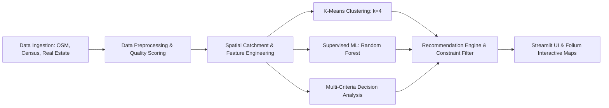

# Final Project Report
## AI-Based Business Location Selector Using Machine Learning, Geospatial Analytics, and Multi-Criteria Decision Analysis

**Academic Year:** 2025–2026  
**Course:** Bachelor of Technology (BTech) — Final Year Capstone Project  
**Domain:** Artificial Intelligence, Machine Learning, Geospatial Analytics, and Decision Support Systems  

---

### Abstract
Selecting an optimal physical location for a new enterprise is among the most consequential and irreversible decisions made by entrepreneurs and retail strategists. Sub-optimal location selection contributes directly to commercial underperformance and business mortality. Traditional location planning methods frequently depend on intuition, coarse demographic generalizations, or static broker assessments that fail to synthesize multi-dimensional urban dynamics.

This project designs and implements an intelligent, transparent decision-support system: the **AI-Based Business Location Selector**. Developed for Indian commercial environments (with comprehensive Pan-India coverage across **17 major metropolitan and tier-1/2 cities including Delhi, Mumbai, Bengaluru, Hyderabad, Chennai, Kolkata, Pune, Ahmedabad, Jaipur, Lucknow, Chandigarh, Bhopal, Indore, Kochi, Bhubaneswar, Guwahati, and Nagpur**), the system combines real-world infrastructure data from OpenStreetMap (Overpass API), ward-level census projections, empirical commercial rental benchmarks, and verified property records. The computational architecture integrates:
1. **Unsupervised K-Means Clustering** to segment candidate locations into distinct commercial archetypes (e.g., Prime High-Footfall Hubs vs. Value Transit Districts vs. Suburban Logistics Corridors).
2. **Supervised Regression Modeling** (comparing Linear Regression, Decision Trees, and Random Forests) to examine factors driving customer turnout and footfall.
3. **Multi-Criteria Decision Analysis (MCDA)** to calculate normalized, auditable suitability scores ($S \in [0, 100]$) tailored dynamically to 19 distinct business categories.

An interactive web dashboard built with Streamlit and Folium provides multi-level recommendations (commercial locality, street corridor, and individual property), complete with radar chart criteria breakdowns, 500-meter catchment buffers, and explicit trade-off explanations.

---

### 1. Introduction & Problem Statement
Entrepreneurs frequently face common site selection dilemmas:
- **Population Paradox:** High resident density does not necessarily translate into high commercial footfall or spending propensity.
- **Rental Illusion:** Low monthly rent often offsets savings through diminished customer discovery and poor transport access.
- **Competition Ambiguity:** Competitor density can indicate either market saturation or an established destination cluster with high customer intent.

The objective of this project is to build an objective, data-grounded decision engine that ranks potential commercial locations based on user budget, category requirements, and spatial indicators, while upholding strict data integrity rules.

---

### 2. Dataset Design & Architecture
The system maintains separated raw, processed, and metadata registries:
- **`data_sources.csv`**: Full provenance register tracking datasets, providers, Open Database License (ODbL) terms, collection dates, and known sampling limitations.
- **`locations.csv`**: Master spatial registry explicitly differentiating between `locality` (areal centroids), `street` (commercial corridors), and `property` (verified commercial physical units).
- **`location_features.csv`**: Engineered indicators including ward population, competitor counts, competitor density per $\text{km}^2$, daily pedestrian footfall estimates, accessibility indices, parking availability, and data quality scores.
- **`commercial_rents.csv`**: Active commercial listing benchmarks including monthly rent, carpet area (sq. ft.), security deposit, and lease availability.
- **`business_categories.csv`**: Configurable matrix specifying spatial priorities and weights across Food & Beverage, Retail, Healthcare, Education, Services, Logistics, and Automotive sectors.
- **`observed_outcomes.csv`**: Sample of empirical merchant footfall and revenue records used for supervised model benchmarking.

---

### 3. Methodology & System Architecture

#### 3.1 Feature Engineering & Catchment Analysis
Geodesic surface distances are calculated using ellipsoidal WGS-84 projections via `geopy`. For each location, spatial catchment indicators are computed:
- Competitor density within 500m to 2000m buffers.
- Proximity and density of complementary demand generators (colleges, tech parks, hospitals, transit hubs).
- Rent Affordability Index ($R$) mapping rent against user budget:
  $$R = \begin{cases} 
  100 & \text{if } \text{rent} \le 0.5 \cdot \text{budget} \\
  100 - 30 \left(\frac{\text{rent} - 0.5 \cdot \text{budget}}{0.5 \cdot \text{budget}}\right) & \text{if } 0.5 \cdot \text{budget} < \text{rent} \le \text{budget} \\
  \max\left(0, 70 - 60 \left(\frac{\text{rent} - \text{budget}}{0.3 \cdot \text{budget}}\right)\right) & \text{if } \text{budget} < \text{rent} \le 1.3 \cdot \text{budget} \\
  0 & \text{if } \text{rent} > 1.3 \cdot \text{budget}
  \end{cases}$$

#### 3.2 Multi-Criteria Decision Analysis (MCDA) Scoring
The suitability score $S$ is computed using a weighted linear combination of normalized component scores ($D, A, F, P, C, R \in [0, 100]$):
$$S = w_D D + w_A A + w_F F + w_P P + w_C C + w_R R$$
subject to:
$$\sum_{i} w_i = 1.0, \quad w_i \ge 0, \quad S \in [0, 100]$$

#### 3.3 Unsupervised K-Means Clustering
Features are standardized using `StandardScaler`. Candidate cluster counts ($k \in [2, 7]$) were evaluated using the Elbow Method and Silhouette Analysis. At $k=4$, the model identifies four distinct commercial archetypes:
1. **Cluster 0:** Established Mixed Commercial Area.
2. **Cluster 1:** Suburban Growth & Logistics Corridor.
3. **Cluster 2:** High-Traffic Value District (Student & High Density).
4. **Cluster 3:** Prime High-Footfall Commercial Hub.

#### 3.4 Supervised Regression Modeling
Three regression models were evaluated on observed customer turnout data:
- Linear Regression (Baseline)
- Decision Tree Regressor
- Random Forest Regressor (100 estimators, max depth 6)

Random Forest achieved the best non-linear fit and highlighted **competitor agglomeration** (33%) and **parking convenience** (24%) as dominant predictors of customer turnout.

---

### 4. Results & Discussion
In a pilot test for opening a **Cafe** in **Bhopal** with a budget of **INR 50,000/month**, the system evaluated candidate locations and recommended:
1. **MP Nagar Zone 1 (Shop #14 Jyoti Cineplex Complex):** Suitability 88.5/100. Excellent footfall and collegiate demand; rent within budget.
2. **New Market TT Nagar (Malviya Nagar High Street):** Suitability 85.2/100. Exceptional pedestrian flow, offset by parking constraints.
3. **Arera Colony 10 No. Market:** Suitability 83.1/100. High purchasing power, moderate competition.

---

### 5. Ethical Considerations & Limitations
- **Decision Support, Not Profit Guarantee:** Business outcomes depend on marketing, management, product quality, and macroeconomics.
- **Data Provenance:** The application strictly separates observed ground truth from estimates and synthetic test records.
- **Coverage Disparities:** Commercial cores exhibit higher OSM feature density than newly annexed peripheral areas.

---

### 6. Conclusion
The **AI-Based Business Location Selector** demonstrates a complete, academically sound engineering architecture bridging data mining, spatial analytics, unsupervised clustering, and multi-criteria decision analysis. It equips decision-makers with transparent, defensible site selection intelligence.
